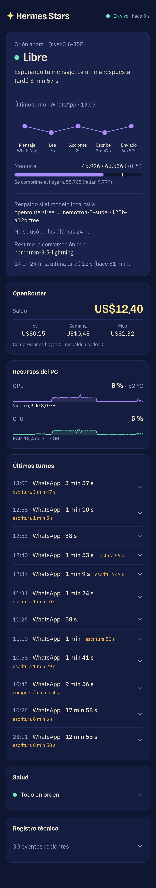
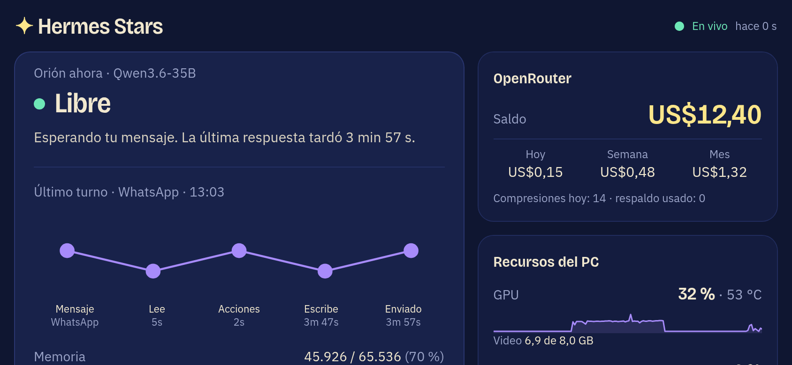
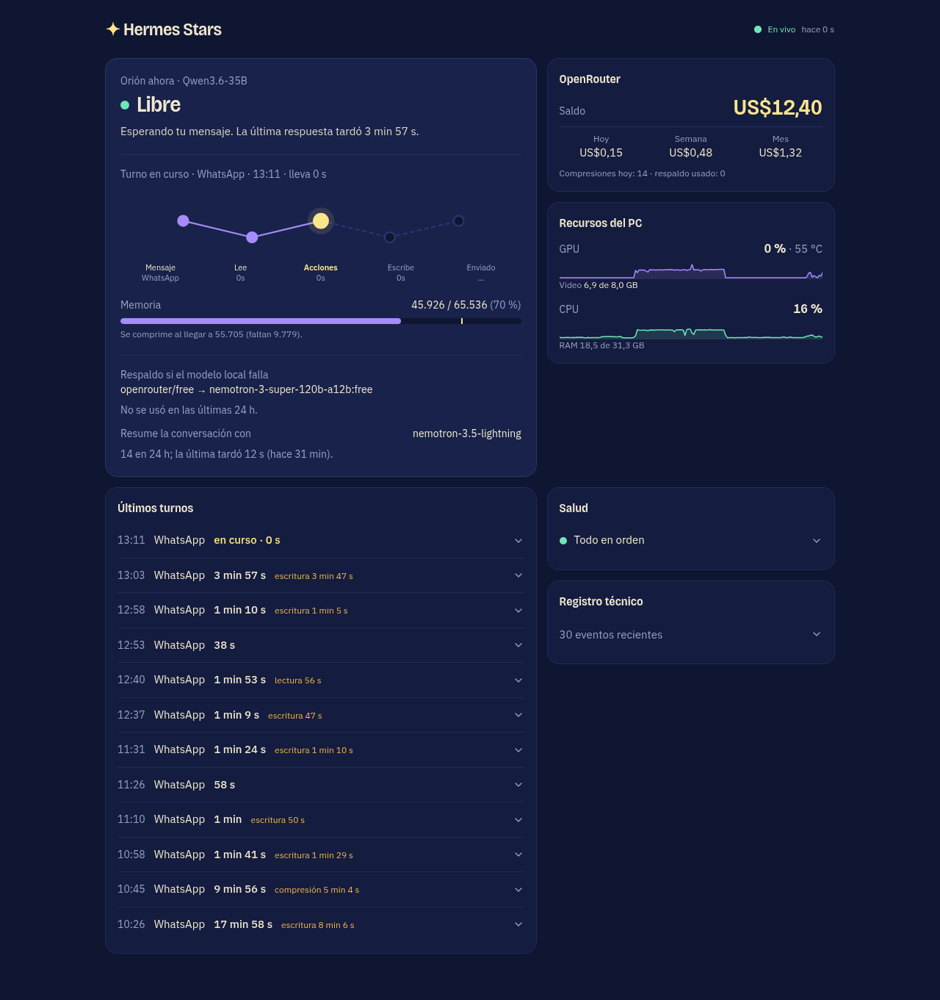

# Hermes Stars

Panel en vivo para vigilar un asistente personal que corre en tu propio PC con
[Hermes Agent](https://github.com/NousResearch/hermes-agent) y un modelo local servido por
[llama.cpp](https://github.com/ggml-org/llama.cpp). Muestra, en lenguaje simple, qué está haciendo el
asistente, cuánto tarda, cuánta memoria le queda, cuánto cuesta el respaldo en la nube y cómo está el
equipo. Se ve bien en celular y en pantalla ancha.



## Qué muestra

| Zona | Qué responde |
| --- | --- |
| **Orión ahora** | Si el asistente está libre, leyendo la conversación, escribiendo, comprimiendo o apagado, con tokens, velocidad y tiempo restante estimado. |
| **Constelación del turno** | Las fases de cada mensaje: mensaje, lee, acciones, comprime, escribe y enviado, con la duración de cada una. |
| **Memoria** | Cuánto contexto lleva usado el modelo y cuánto falta para que se comprima la conversación. |
| **Respaldo y compresión** | Qué modelo de la nube entra si el local falla, cuántas veces se usó en 24 h y con qué modelo se resume la conversación. |
| **OpenRouter** | Saldo, gasto de hoy, de la semana y del mes, con aviso si el saldo es bajo. |
| **Recursos del PC** | GPU (uso, memoria de video, temperatura), CPU y RAM, con gráficos de los últimos minutos. |
| **Últimos turnos** | Cada mensaje con su desglose por fases, herramientas usadas y errores. |
| **Salud** | Si el modelo, el gateway y los canales de mensajería responden. |
| **Registro técnico** | Los eventos recientes, plegado por defecto. |





El panel nunca recibe el contenido de los mensajes: solo cifras, duraciones y nombres de eventos.

## Cómo funciona

```
 tu PC                                              la nube
┌──────────────────────────────┐               ┌───────────────────┐    ┌──────────────┐
│ llama.cpp   (/health /slots) │               │     Supabase      │◄───│  Panel web   │
│ Hermes      (gateway.log,    │  recolector   │  (Postgres + RLS) │    │  (Next.js en │
│              agent.log)      ├──────────────►│  tablas de        │    │   Vercel)    │
│ nvidia-smi, CPU, RAM         │  Python       │  métricas         │    └──────────────┘
│ OpenRouter  (saldo, gasto)   │               └───────────────────┘
└──────────────────────────────┘
```

1. **Recolector** (`collector/collector.py`): un servicio de usuario de systemd que cada 3 segundos
   lee el estado del modelo, la GPU, la CPU y los logs de Hermes, y cada 60 segundos consulta
   OpenRouter. Escribe en Supabase con la clave `service_role`.
2. **Supabase**: guarda las métricas. El panel las lee con la clave pública (`anon`), protegida por
   políticas RLS de solo lectura.
3. **Panel** (`src/app`): una página de Next.js que consulta Supabase cada 2 segundos.

## Requisitos

- Linux con systemd (probado en CachyOS / Arch).
- Hermes Agent con sus logs en `~/.hermes/logs/` y `llama-server` iniciado con `--metrics`.
- GPU NVIDIA con `nvidia-smi` (si usas otra, hay que adaptar la función de GPU del recolector).
- Python 3.11 o superior y Node.js 20 o superior.
- Una cuenta gratuita de [Supabase](https://supabase.com) y otra de [Vercel](https://vercel.com).
- Opcional: una clave de [OpenRouter](https://openrouter.ai) para ver saldo y gasto.

## Instalación

### 1. Base de datos

1. Crea un proyecto en Supabase.
2. En **Database → Extensions**, activa `pg_cron`.
3. En **SQL Editor**, pega y ejecuta el contenido de [`supabase/schema.sql`](supabase/schema.sql). Crea las
   tablas, las políticas de lectura pública, y una limpieza diaria que borra las métricas de más de
   7 días y los turnos, eventos y datos de la nube de más de 30.
4. En **Project Settings → API**, anota la URL del proyecto, la clave `anon` (pública) y la clave
   `service_role` (secreta).

### 2. Recolector

```bash
cd collector
python -m venv venv
venv/bin/pip install -r requirements.txt
cp .env.example .env
```

Edita `.env` con tus datos (la clave `service_role` va solo aquí, nunca en el panel):

```
SUPABASE_URL=https://xxxxxxxx.supabase.co
SUPABASE_SERVICE_ROLE_KEY=...
OPENROUTER_API_KEY=...            # opcional
```

Prueba que funciona antes de instalarlo como servicio:

```bash
venv/bin/python collector.py
```

Para dejarlo corriendo siempre, copia `hermes-monitor-collector.service.example` a
`~/.config/systemd/user/hermes-monitor-collector.service`, reemplaza `RUTA` por la ruta real del
proyecto y actívalo:

```bash
systemctl --user daemon-reload
systemctl --user enable --now hermes-monitor-collector.service
```

#### Variables del recolector

| Variable | Por defecto | Para qué sirve |
| --- | --- | --- |
| `SUPABASE_URL` | obligatoria | URL del proyecto Supabase. |
| `SUPABASE_SERVICE_ROLE_KEY` | obligatoria | Clave con permiso de escritura. |
| `OPENROUTER_API_KEY` | vacía | Habilita saldo y gasto en la nube. |
| `HERMES_HOME` | `~/.hermes` | Carpeta de Hermes. |
| `HERMES_GATEWAY_LOG` / `HERMES_AGENT_LOG` | `$HERMES_HOME/logs/…` | Logs que se leen para detectar turnos y compresiones. |
| `HERMES_CONFIG` | `$HERMES_HOME/config.yaml` | Para leer la cadena de respaldo y el modelo de compresión. |
| `LLAMA_HEALTH_URL`, `LLAMA_METRICS_URL`, `LLAMA_SLOTS_URL` | `http://127.0.0.1:8081/…` | Dirección de `llama-server`. |
| `COLLECTOR_POLL_INTERVAL` | `3` | Segundos entre lecturas locales. |
| `COLLECTOR_CLOUD_POLL_INTERVAL` | `60` | Segundos entre consultas a OpenRouter. |

### 3. Panel

```bash
cp .env.local.example .env.local
npm install
npm run dev
```

En `.env.local` pon la URL de Supabase y la clave **pública** (`anon`):

```
NEXT_PUBLIC_SUPABASE_URL=https://xxxxxxxx.supabase.co
NEXT_PUBLIC_SUPABASE_ANON_KEY=...
```

Abre <http://localhost:3000>. Para publicarlo:

```bash
npm i -g vercel
vercel --prod
```

Agrega las dos variables `NEXT_PUBLIC_…` en el proyecto de Vercel (**Settings → Environment Variables**)
y vuelve a desplegar.

## Privacidad y seguridad

- El panel es **público** si publicas la URL: cualquiera que la conozca ve las cifras. Elige un nombre de
  proyecto difícil de adivinar o activa la protección de Vercel si no quieres eso.
- No se sube el texto de ningún mensaje, solo duraciones, cantidades y nombres de eventos.
- La clave `service_role` solo vive en el `.env` del recolector, que está en `.gitignore`.
- Las políticas RLS dejan al panel únicamente leer. Si alguien obtiene la clave `anon`, no puede escribir.

## Estructura

```
collector/          recolector Python y servicio de systemd
supabase/schema.sql esquema, políticas de lectura y limpieza diaria
src/app/page.tsx    el panel completo
src/app/globals.css colores y animaciones
docs/               notas de diseño e imágenes
```

## Adaptarlo a otro proyecto

El recolector está pensado para Hermes + llama.cpp + NVIDIA. Si tu stack es otro:

- **Otro servidor de modelos:** cambia las tres URLs `LLAMA_*`. Debe exponer salud y, si quieres tokens y
  velocidad, métricas en formato Prometheus.
- **Otra GPU:** reemplaza la lectura de `nvidia-smi` por la herramienta de tu fabricante; solo importa que
  escriba `util_pct`, `vram_used_mb`, `vram_total_mb`, `temp_c` y `power_w` en `gpu_metrics`.
- **Otro agente:** los turnos y las compresiones salen de leer `gateway.log` y `agent.log` con expresiones
  regulares. Si tu agente escribe otros logs, hay que ajustar las constantes `*_RE` de `collector.py`
  (se ven con `grep _RE collector/collector.py`).
- Algunos textos del panel mencionan a "Orión" y al modelo usado; están en `src/app/page.tsx`.

## Desarrollo

```bash
npm run dev      # servidor local
npm run build    # compila para producción
```

Stack: Next.js 16, Tailwind CSS 4, Supabase, Python.
